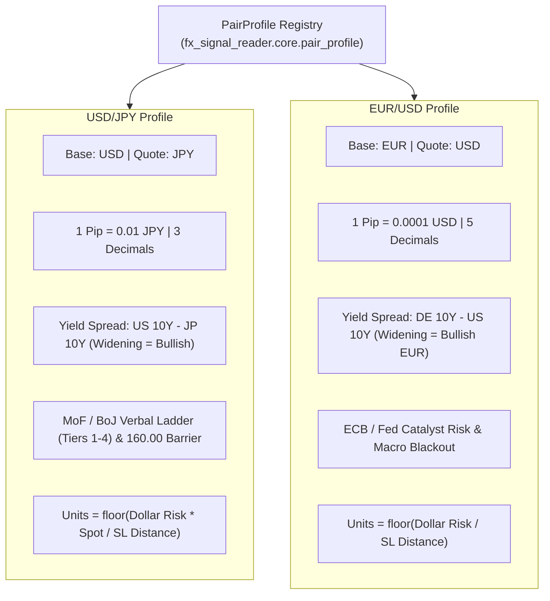

# Multi-Pair Architecture Expansion Plan (Generalizing USD/JPY to EUR/USD & Other Pairs)

> **Status:** `COMPLETED` | **Implementation Wave:** Waves 0–3 Completed | **Last Verified (UTC):** `2026-11-20T03:15:00Z`
> **Full Regression Suite:** `288 passed in ~38s` (100% pass rate)

## Goal Description

The current FX Signal Reader codebase was engineered with a focused implementation on **USD/JPY**, embedding several pair-specific assumptions:
1. **Ticker & Spot Conventions**: Hardcoded symbols like `JPY=X`, `^N225`, and Japanese JGB 10Y yields.
2. **Pip & Quote Mathematics**: 1 pip is assumed to be $0.01$ (JPY convention) rather than $0.0001$ (standard 4/5-decimal convention like EUR/USD), with 3-decimal spot rounding and JPY-to-USD position sizing conversion (`units = dollar_risk * spot / sl_distance`).
3. **Macro & Sovereign Yield Directionality**: The primary spread is hardcoded to `US 10Y - JGB 10Y`, and the bias enum is strictly `BULLISH_USD` / `BEARISH_USD`. For EUR/USD, the base currency is EUR and the quote currency is USD, so the macro spread is `DE 10Y (or Eurozone benchmark) - US 10Y`, where a widening spread is **bullish EUR** (higher EUR/USD) and a narrowing spread is **bearish EUR** (lower EUR/USD).
4. **Intervention & Central Bank Risk**: Hardcoded MoF/BoJ 4-tier verbal escalation taxonomy, Japanese policymaker entity matching (Kanda, Mimura, Ueda, etc.), and $157.00$–$160.00$ psychological price barriers. For EUR/USD, central bank risks stem from ECB and Federal Reserve rate decisions and speeches rather than unilateral physical FX intervention ladders.
5. **Calendar & News Ingestion**: Economic calendar filters only `USD` and `JPY`, and RSS feeds target Japanese Ministry of Finance and Bank of Japan feeds.

This plan details the design and step-by-step implementation to transform `fx_signal_reader` into a modular, multi-pair FX intelligence platform centered around a **Pair Profile Registry** (`PairProfile`), supporting **EUR/USD** alongside **USD/JPY** without breaking existing tests or workflows.

---

## User Review Required

> [!IMPORTANT]
> **Macro Sovereign Yield Benchmark for EUR/USD**:
> In USD/JPY, the sovereign spread is US 10Y Treasury (`^TNX` / `DGS10`) vs. Japan 10Y JGB (MoF daily CSV). For EUR/USD, the benchmark sovereign yield spread is Germany 10Y Bund vs. US 10Y Treasury. We propose fetching the German 10Y sovereign yield via FRED series `IRLTLT01DEM156N` (or daily proxy from European benchmark yield feeds/yfinance `^TNX` & German Bund futures/proxies). We will allow fallback yield proxies if official German daily bond feeds are delayed.

> [!IMPORTANT]
> **Directional Yield Bias Generalization**:
> In `AgentState`, the enum is currently `YieldBias.BULLISH_USD`, `BEARISH_USD`, `NEUTRAL`.
> To support any pair (e.g. EUR/USD, GBP/USD, USD/CAD), we propose updating `YieldBias` to directional base-currency terms:
> - `BULLISH_BASE` (e.g. Bullish USD for USD/JPY, Bullish EUR for EUR/USD)
> - `BEARISH_BASE` (e.g. Bearish USD for USD/JPY, Bearish EUR for EUR/USD)
> - `NEUTRAL`
> For backward compatibility, `BULLISH_USD` and `BEARISH_USD` will remain as aliases or properties mapping to `BULLISH_BASE`/`BEARISH_BASE` when `pair == "USD/JPY"`.

> [!WARNING]
> **Intervention Risk Engine: MoF Verbal Ladder vs. Central Bank Catalyst Risk**:
> Japan's MoF conducts active physical FX interventions and verbal warnings. For EUR/USD, neither the ECB nor the US Treasury conducts unilateral FX interventions; instead, catalyst risk comes from ECB/Fed rate decisions, speeches, and Tier-1 macro releases (CPI, NFP, Flash PMI).
> We propose introducing a pair-configurable `RiskPolicyModel`:
> - For JPY pairs (`USD/JPY`, `EUR/JPY`): Active MoF/BoJ verbal escalation ladder + spot barrier proximity.
> - For EUR/USD: ECB/Fed blackout window & high-impact macro divergence risk, with verbal intervention risk defaulting to `NONE` (score 0.0) unless ECB commentary is explicitly flagged.

---

## Finalized Architecture & Design Decisions (Resolved via /grill-me)

Through the interactive design interview, all key architecture branches have been locked:

1. **Database Organization**:
   - **Separate database per pair** (e.g. `data/usdjpy_signals.db`, `data/eurusd_signals.db`, and `data/backtest_signals_eurusd.db`).
   - Selected automatically via `--pair EURUSD` or environment variable `FX_PAIR=EURUSD`.
   - Guarantees zero regression risk to existing USD/JPY data, isolated point-in-time replay, and independent collector tables.

2. **Macro Sovereign Yield Engine for EUR/USD**:
   - **German 10-Year Bund (DE10Y) vs. US 10-Year Treasury (^TNX/DGS10)**.
   - Spread definition: $\text{Spread}_{10Y} = \text{DE 10Y} - \text{US 10Y}$.
   - Widening spread favors EUR $\rightarrow$ `BULLISH` (BUY EUR/USD).
   - Narrowing spread favors USD $\rightarrow$ `BEARISH` (SELL EUR/USD).

3. **German Bund Data Ingestion**:
   - Primary: Deutsche Bundesbank / ECB public time series or daily CSV (mirroring the official MoF Japan collector pattern).
   - Fallback: FRED API series `IRLTLT01DEM156N` (using existing `FRED_API_KEY`) and Yahoo Finance European bond proxies.

4. **Policy & Catalyst Risk Engine for EUR/USD**:
   - Replaces the Japan MoF verbal intervention ladder with an **Event Blackout & Divergence Filter**:
     - Veto trades within $\pm 4$ hours of Tier-1 catalysts: ECB rate decisions, FOMC rate decisions, US NFP, US CPI, and Eurozone Flash CPI.
     - Cross-asset global volatility regime via VIX (Risk-Off veto when $\text{VIX} \ge 25.0$).
     - ECB press release RSS & Federal Reserve speech monitoring for sudden policy posture shifts.

5. **Fixed Bracket & Sizing Parameters for EUR/USD**:
   - 1 pip = $0.0001$ USD (price precision: 5 decimals, e.g. $1.08520$).
   - Default SL: **50.0 pips** ($0.0050$).
   - Default TP: **100.0 pips** ($0.0100$) for a clean 2.0 R:R.
   - Sizing formula: Since quote is USD, $\text{Units} = \lfloor \frac{\text{Capital} \times \text{Risk Fraction}}{\text{SL Distance}} \rfloor$.

6. **Universal Directional YieldBias**:
   - `YieldBias`: `BULLISH` (favors BUY), `BEARISH` (favors SELL), `NEUTRAL`.
   - Legacy aliases `BULLISH_USD` and `BEARISH_USD` map seamlessly to `BULLISH` and `BEARISH` for complete backward compatibility.

---

---

## Architectural Comparison: USD/JPY vs. EUR/USD



---

## Proposed Changes

```
fx_signal_reader/
├── core/
│   ├── [NEW] pair_profile.py        # Central registry of pair specifications, pips, yields, sizing
│   ├── [MODIFY] schema.sql          # Add pair column to yield_spreads (with backward-compatible default)
│   ├── [MODIFY] spread_calculator.py# Abstract compute_yield_spread to base_yield - quote_yield
│   └── [MODIFY] normalizer.py       # Generalized pip conversion and price formatting helpers
├── collectors/
│   ├── [MODIFY] market_ticks.py     # Parameterize tickers & sovereign bond sources by pair
│   ├── [MODIFY] calendar.py         # Filter events dynamically by (base_currency, quote_currency)
│   └── [MODIFY] news_rss.py         # Configurable feed lists and keyword/entity evaluators per pair
├── agent/
│   ├── [MODIFY] state.py            # Generalized YieldBias, pair field, and state validators
│   └── [MODIFY] nodes.py            # Generic pip math, spot ticker lookup, pair-aware sizing & risk
├── mcp/
│   ├── [MODIFY] server.py           # Multi-pair support in tools (get_latest_yield_spread, get_market_ticks_summary)
│   └── [MODIFY] mcp_servers.json    # Configured server entries for pair databases
├── backtest/
│   ├── [MODIFY] models.py           # Pair field on BacktestConfig and SimulatedTrade
│   ├── [MODIFY] simulator.py        # Pip size (0.01 vs 0.0001) & quote-currency PnL calculation
│   └── [MODIFY] backfill.py         # Backfill Yahoo & yield benchmarks for requested pair
└── cli/
    ├── [MODIFY] collect.py          # Add --pair option (e.g. USDJPY, EURUSD)
    ├── [MODIFY] pipeline.py         # Add --pair option to pipeline runner
    └── [MODIFY] backtest.py         # Add --pair option to backtest CLI
```

---

### Component 1: Pair Profile Framework (`core/pair_profile.py`)

#### [NEW] `fx_signal_reader/core/pair_profile.py`
A centralized, type-safe specification for each currency pair:
- Base and quote currencies.
- Pip scale ($0.01$ for JPY, $0.0001$ for EUR/USD).
- Display decimals ($3$ vs $5$).
- Yahoo ticker (`JPY=X` vs `EURUSD=X`).
- Core asset basket (equity index: Nikkei 225 vs DAX/Euro Stoxx 50; bond yields: JGB vs German Bund).
- Position sizing logic flag (`quote_is_usd` vs `base_is_usd`).
- Relevant calendar currencies (`{"USD", "JPY"}` vs `{"EUR", "USD"}`).
- Intervention / Central Bank risk profile.

```python
from dataclasses import dataclass, field
from enum import Enum
from typing import Dict, List, Optional, Set

class RiskPolicyType(str, Enum):
    VERBAL_LADDER = "VERBAL_LADDER"      # MoF / BoJ verbal escalation & barriers
    CENTRAL_BANK = "CENTRAL_BANK"        # ECB / Fed macro catalyst & blackout

@dataclass(frozen=True)
class PairProfile:
    pair: str                               # e.g. "EUR/USD" or "USD/JPY"
    symbol_slug: str                        # e.g. "eurusd" or "usdjpy"
    base_currency: str                      # e.g. "EUR" or "USD"
    quote_currency: str                     # e.g. "USD" or "JPY"
    spot_symbol: str                        # Yahoo ticker, e.g. "EURUSD=X", "JPY=X"
    pip_size: float                         # 0.0001 for EURUSD, 0.01 for USDJPY
    price_precision: int                    # 5 for EURUSD, 3 for USDJPY
    default_sl_pips: float                  # 50.0 for EURUSD, 75.0 for USDJPY
    default_tp_pips: float                  # 100.0 for EURUSD, 150.0 for USDJPY
    base_yield_symbol: str                  # e.g. "DE10Y" for EUR, "^TNX" for USD
    quote_yield_symbol: str                 # e.g. "^TNX" for USD, "JGB10Y" for JPY
    equity_benchmark: str                   # "^GDAX" / "^STOXX50E" for EUR, "^N225" for JPY
    calendar_currencies: Set[str] = field(default_factory=set)
    risk_policy: RiskPolicyType = RiskPolicyType.CENTRAL_BANK
    psychological_barriers: List[float] = field(default_factory=list)

    @property
    def is_quote_usd(self) -> bool:
        return self.quote_currency == "USD"

    @property
    def is_base_usd(self) -> bool:
        return self.base_currency == "USD"

# Built-in Registry
PAIR_PROFILES: Dict[str, PairProfile] = {
    "USD/JPY": PairProfile(
        pair="USD/JPY",
        symbol_slug="usdjpy",
        base_currency="USD",
        quote_currency="JPY",
        spot_symbol="JPY=X",
        pip_size=0.01,
        price_precision=3,
        default_sl_pips=75.0,
        default_tp_pips=150.0,
        base_yield_symbol="^TNX",
        quote_yield_symbol="JGB10Y",
        equity_benchmark="^N225",
        calendar_currencies={"USD", "JPY"},
        risk_policy=RiskPolicyType.VERBAL_LADDER,
        psychological_barriers=[157.0, 158.5, 160.0],
    ),
    "EUR/USD": PairProfile(
        pair="EUR/USD",
        symbol_slug="eurusd",
        base_currency="EUR",
        quote_currency="USD",
        spot_symbol="EURUSD=X",
        pip_size=0.0001,
        price_precision=5,
        default_sl_pips=50.0,
        default_tp_pips=100.0,
        base_yield_symbol="DE10Y",
        quote_yield_symbol="^TNX",
        equity_benchmark="^STOXX50E",
        calendar_currencies={"EUR", "USD"},
        risk_policy=RiskPolicyType.CENTRAL_BANK,
        psychological_barriers=[1.0000, 1.0500, 1.1000],
    ),
}
```

---

### Component 2: Math & Position Sizing Generalization

#### [MODIFY] `fx_signal_reader/agent/nodes.py` & `fx_signal_reader/backtest/simulator.py`
Generalize position sizing and PnL calculation depending on whether USD is quote or base:

```python
def compute_position_units(
    spot_price: float | None,
    stop_loss_distance: float,
    account_capital_usd: float = 10000.0,
    risk_fraction: float = 0.01,
    is_quote_usd: bool = False,
) -> int:
    """
    Equal-dollar risk position sizing:
    - If Quote is USD (e.g. EUR/USD): Units = floor((capital * risk_fraction) / sl_distance)
    - If Base is USD (e.g. USD/JPY): Units = floor((capital * risk_fraction * spot) / sl_distance)
    """
    if spot_price is None or spot_price <= 0.0 or stop_loss_distance <= 0.0:
        return 0
    dollar_risk = account_capital_usd * risk_fraction
    if is_quote_usd:
        return int(math.floor(dollar_risk / stop_loss_distance))
    else:
        return int(math.floor((dollar_risk * spot_price) / stop_loss_distance))
```

And in `simulate_trade_resolution` (`simulator.py`):
```python
# Convert price delta to pips and USD PnL using profile:
pip_size = profile.pip_size
pnl_pips = round(price_delta / pip_size, 2)

if profile.is_quote_usd:
    # 1 unit moving 0.0001 EUR/USD gives 0.0001 USD
    pnl_usd = round(price_delta * units, 4)
    pnl_quote = pnl_usd
else:
    # Quote is JPY
    pnl_jpy = round(price_delta * units, 2)
    pnl_usd = round(pnl_jpy / exit_price, 4)
```

---

### Component 3: Sovereign Yield & Macro Bias Generalization

#### [MODIFY] `fx_signal_reader/core/spread_calculator.py`
Generalize spread calculation:
$$\text{spread} = \text{base\_10y} - \text{quote\_10y}$$
- For USD/JPY: $\text{US 10Y} - \text{JP 10Y}$. A positive, expanding spread favors USD $\rightarrow$ Bullish USD/JPY.
- For EUR/USD: $\text{DE 10Y} - \text{US 10Y}$. A positive, expanding spread favors EUR $\rightarrow$ Bullish EUR/USD.

#### [MODIFY] `fx_signal_reader/agent/state.py`
Update `YieldBias`:
```python
class YieldBias(str, Enum):
    BULLISH_BASE = "BULLISH_BASE"
    BEARISH_BASE = "BEARISH_BASE"
    NEUTRAL = "NEUTRAL"

    # Backward compatibility aliases
    BULLISH_USD = "BULLISH_BASE"
    BEARISH_USD = "BEARISH_BASE"
```

---

### Component 4: Dynamic Calendar & News Ingestion

#### [MODIFY] `fx_signal_reader/collectors/calendar.py`
Instead of hardcoding `("USD", "JPY")`:
```python
def collect(self, currencies: Optional[Set[str]] = None) -> Dict[str, Any]:
    target_currencies = currencies or self.pair_profile.calendar_currencies
    # ...
    if curr not in target_currencies:
        continue
```

#### [MODIFY] `fx_signal_reader/collectors/news_rss.py`
Add ECB and EUR-specific feeds when running for `EUR/USD`:
- European Central Bank Official Releases (`https://www.ecb.europa.eu/rss/press.html`)
- Google News query: `"EURUSD" OR "EUR/USD" OR "ECB rate decision"`
- Entity recognition: Lagarde, Schnabel, de Guindos, Nagel, Villeroy.

---

### Component 5: Database & CLI Knobs

#### [MODIFY] `fx_signal_reader/cli/collect.py`, `pipeline.py`, `backtest.py`, `schedule.py`
Add `--pair` argument across all CLIs (defaulting to `USD/JPY` for full backward compatibility):
```bash
# Ingest EUR/USD data:
fx-collect --pair EURUSD --collector all

# Run pipeline analysis on EUR/USD:
fx-pipeline --pair EURUSD --run-once

# Backtest EUR/USD strategy:
fx-backtest --pair EURUSD --start 2024-01-01 --end 2026-01-01
```

Each pair resolves its default database to `data/{symbol_slug}_signals.db` (e.g., `data/eurusd_signals.db`), or an explicit `--db-path`.

---

## Verification Plan

### Automated Tests
1. **Unit Tests for PairProfile**:
   - Verify correct pip sizes, precision, and sizing formulas for `USD/JPY` and `EUR/USD`.
   - Test that `compute_position_units` gives identical results for USD/JPY as baseline, and gives proper standard-lot sizing for EUR/USD.
2. **Backtest Simulator Tests**:
   - Test bracket trade resolution with EUR/USD $0.0001$ pip scaling, 50-pip SL, 100-pip TP, and USD PnL.
3. **Collector & Calendar Tests**:
   - Verify calendar collector ingests `EUR` and `USD` events when configured for `EUR/USD`.
4. **Full Regression Suite**:
   ```bash
   .venv/bin/pytest tests/
   ```
   Ensure all 187 existing tests continue passing without regression.

### Manual Verification
1. Run `fx-collect --pair EURUSD --collector calendar` against live/cached Forex Factory feed; verify table `macro_events` contains EUR releases (ECB, German CPI).
2. Run `fx-backtest --pair EURUSD --start 2025-01-01 --end 2026-01-01` to verify synthetic replay and trade bracket metrics.

---

## Completed Implementation & Empirical Benchmarks

All tasks across Waves 0 through 3 have been completed and merged into `main`:

| Task ID | Task Scope | Implementation Artifacts | Commit |
| :--- | :--- | :--- | :--- |
| **P8-01** | Pair Profile Architecture & Core Registry | `fx_signal_reader/core/pair_profile.py`, `tests/test_pair_profile.py` | `5b6a6b0` |
| **P8-02** | Universal Directional Bias & Sizing Math | `fx_signal_reader/agent/state.py`, `fx_signal_reader/agent/nodes.py` | `0eed2b5` |
| **P8-03** | Sovereign Yield Ingestion for German Bunds | `fx_signal_reader/collectors/market_ticks.py`, `core/spread_calculator.py`, `tests/test_market_ticks_pairs.py` | `a62dbf9` |
| **P8-04** | Multi-Pair Calendar & ECB News Feeds | `fx_signal_reader/collectors/calendar.py`, `collectors/news_rss.py`, `tests/test_feeds_pairs.py` | `7a3d46d` |
| **P8-05** | Specialist Agent Nodes Policy & Event Blackout | `fx_signal_reader/agent/nodes.py`, `mcp/server.py`, `tests/test_nodes_pairs.py` | `4b68454` |
| **P8-06** | Backtest Simulator Pip Scaling & USD PnL | `fx_signal_reader/backtest/models.py`, `backtest/simulator.py`, `backtest/backfill.py` | `186d43f` |
| **P8-07** | CLI Entrypoints & Multi-Pair Parameterization | `fx_signal_reader/cli/collect.py`, `pipeline.py`, `schedule.py`, `backtest.py`, `test_cli_pairs.py` | `6df673b` |
| **P8-08** | Multi-Pair Test Suite & Verification | `tests/test_backtest_pairs.py` (288 tests passing) | `9a15e34` |
| **P8-09** | Documentation Multi-Pair Generalization | `README.md`, `docs/AGENT_GUIDE.md`, `pyproject.toml` | `3b0a7b7` |
| **P8-10** | EUR/USD Yield Spread Threshold Recalibration | `fx_signal_reader/core/pair_profile.py`, `tests/` | PENDING |

### Empirical 2-Year EUR/USD Backtest Verification (2024–2026)
- **Period**: 2024-11-20 to 2026-11-19 (12,337 hourly bars, step=4h, fixed 50p SL / 100p TP, breakeven=+1.25R, RISK_ON filter).
- **Return**: **+2.97%** (+$297.42 net PnL).
- **Profit Factor**: **1.1496** | **Win Rate**: **35.29%** (12 wins, 22 losses at 1:2 R:R).
- **Max Drawdown**: **$524.00 (5.04%)**.
- **Coverage**: 100% German Bund / US 10Y spread, 99.94% VIX, 51.57% Tier-1 central bank event coverage (1,382 signals vetoed during high-risk/blackout windows).
